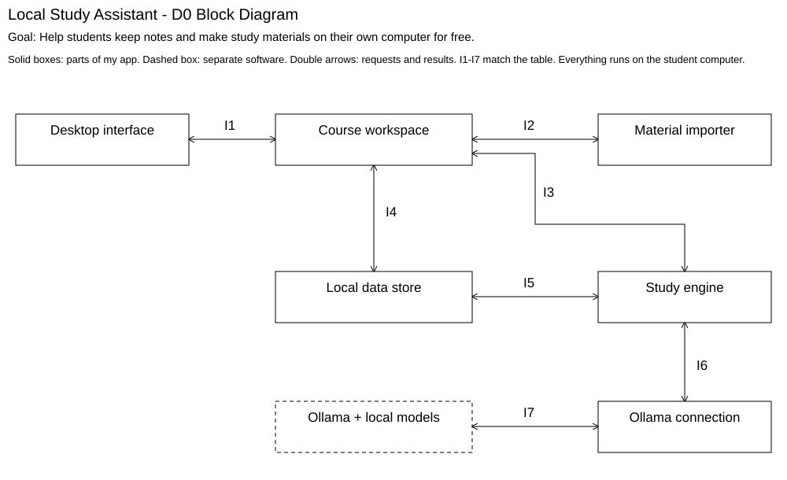
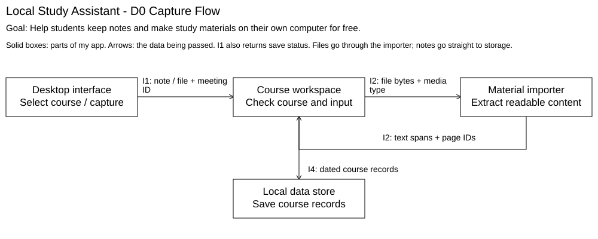
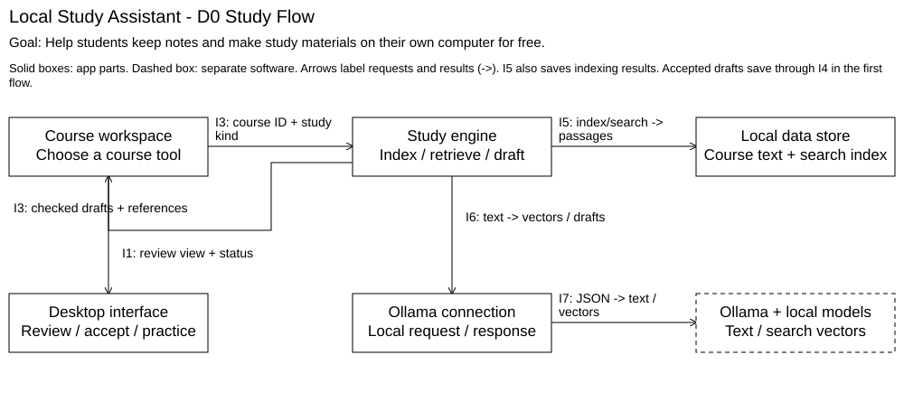

# D0 High-Level Design

## 1. Title, goal statement, and conventions

Local Study Assistant - Design D0 | Jason Galanie

Goal: Help students keep notes and make study materials on their own computer for free.

I want students to install one free app for their class notes, slides, and study tools. The input is their course schedule, uploaded material, typed notes, and study requests. The output is saved course history plus recaps, flashcards, guides, and practice quizzes linked to the original material.

Courses appear as tabs with a plus button to add one. The student picks meeting times on a calendar. Notes and uploads stay organized by class date. Each item belongs to one course, with an optional class meeting. Study tools use the selected course library by default.

The library stays on the computer. Meaning-based search finds relevant passages for the local AI model instead of sending a whole semester in one prompt. Setup guides the student through Ollama and the models needed for generation and search. These features describe the planned release, not everything in the current prototype.

## 2. Block diagram (the D0 diagram)



The six app components have separate jobs. Ollama and its downloaded models are external software on the same computer. Double arrows include requests and results, not separate network services. The same interface IDs are used throughout this document.

## 3. Component responsibility table

I am the only team member, so I own each app component and the Ollama integration.

| Component | Main responsibility | Interfaces in / out | Owner |
| --- | --- | --- | --- |
| Desktop interface | Present course, capture, setup, study, and source-navigation screens. | I1: actions out; results and job status in. | Jason Galanie |
| Course workspace | Coordinate operations for the selected course and class meeting. | I1: actions in; I2-I4: requests out; results return on each. | Jason Galanie |
| Material importer | Turn readable files into text sections with source locations. | I2: files in; sections or errors out. | Jason Galanie |
| Study engine | Produce study drafts from the selected course library. | I3: task in/status out; I5: library operations; I6: model requests out. | Jason Galanie |
| Ollama connection | Translate app tasks into calls to the local model runtime. | I6: task in/result out; I7: HTTP request out/response in. | Jason Galanie |
| Local data store | Keep course records and searchable source information on the device. | I4: course read/write requests; I5: search/index requests; results out. | Jason Galanie |
| Ollama + local models (external) | Run text generation or create search embeddings. | I7: request in; text or vectors out. | Jason Galanie (integration only) |

These are logical boundaries inside one app. The importer does not make study answers, the model connection does not select courses, and the model cannot write over notes. The study engine manages the library/search workflow; the data store holds the records it needs.

| Existing user story | Components that make it possible |
| --- | --- |
| US-01: study guides | Interface, workspace, importer, study engine, store, model connection, and local Ollama. |
| US-02: questions and feedback | Interface, workspace, study engine, store, model connection, and local Ollama. |
| US-03: local generation | Setup interface, model connection, study engine, local store, and local Ollama. |
| US-04: accessible practice | Interface for keyboard/screen-reader access; workspace and engine for practice results. |
| US-05: notes beside slides | Interface, workspace, importer, and store; engine/model connection for optional AI help. |

Scope clarified after the interviews: calendar-based course setup, meeting history, meaning-based course search, direct source links, and background generation are my proposed design choices. They are not claims that interviewees requested or tested those exact features.

## 4. Interface specification table

I1-I6 use named records passed through internal request/response calls. They are not public web APIs. I7 uses local HTTP. Each request either returns its named result or Error {code: string, message: string, retryable: boolean}. Background tasks can report a later error through their job status.

| ID / connection | Input (named types) | Output (named types) | Format / protocol | Failure / handler |
| --- | --- | --- | --- | --- |
| I1<br>Interface / workspace | action: string; courseId: string; sessionId: string or null; data: ActionData. Actions: save, upload, study, status, openSource, setup. | status: string; records: Record[]; job: JobStatus or null; error: Error or null. | Named app records / internal call. | Workspace rejects invalid input or a missing course. Interface keeps unsaved text, labels the error, and leaves other controls usable. |
| I2<br>Workspace / importer | sourceId: string; name: string; mediaType: string; bytes: byte[]. | sourceId: string; sections: SourceSection[]; warnings: string[]. | File bytes + named records / internal call. | Importer rejects unsupported, unreadable, or oversized files. Workspace shows the reason. A note saved separately remains available. |
| I3<br>Workspace / study engine | courseId: string; kind: string (recap, guide, flashcard, quiz, index); scope: string (allCourse); topic: string or null. Status uses jobId: string. Practice uses itemId/answer: strings. | job: JobStatus; items: StudyItem[]; feedback: string or null. Index jobs return no study items. | Named task/result records / internal call; submit returns a job ID, status calls return progress. | Engine reports missing evidence, unready search data, or invalid drafts. Workspace exposes the failed job and Retry. Originals are unchanged. |
| I4<br>Workspace / data store | operation: string (read, save, delete, resolve); type: string; ids: string[]; record: Record or null. | records: Record[]; committed: boolean; location: SourceLocation or null. | Named records / transactional local-storage call. | Store cancels failed writes. Workspace shows unsaved state; interface retains text. A missing source link shows an error, not a different source. |

Shared types: [] means a list. Course {id, name: string; meetings: Meeting[]}. Meeting {weekday: integer; startTime, endTime, timeZone, startDate, endDate: string}. Local times use HH:mm, dates YYYY-MM-DD, and timeZone is a named zone. A ClassSession has id/courseId/date: strings.

Note {id, courseId, text, capturedAt: string; sessionId: string or null}. capturedAt uses ISO 8601 with an offset. Upload metadata has id/courseId/name/mediaType: strings and sessionId: string or null. ActionData carries the named note, upload, study fields, job ID, source reference, or model settings relevant to the action. A saved Record is a course, session, note, upload/source section, study item, or settings record.

## 4. Interface specification table (continued)

| ID / connection | Input (named types) | Output (named types) | Format / protocol | Failure / handler |
| --- | --- | --- | --- | --- |
| I5<br>Study engine / store | operation: string (read, index, search); courseId, modelId: string; scope: string (allCourse); queryVector: number[] or null; entries: IndexEntry[]. | sections: SourceSection[]; searchReady: boolean; affectedIds: string[]. | Named records with numeric vectors / internal storage call. | Store rejects wrong-course references, missing sources, or incompatible search data. Engine pauses/rebuilds the index before retry; no silent cross-course search. |
| I6<br>Study engine / Ollama connection | operation: string (embed, generate); modelId: string; texts: string[]; instructions: string or null. | vectors: number[][] or null; generatedText: string or null; modelId: string. | Named app records / internal call. Model output is untrusted text until the engine checks it. | Connection reports model unavailable, invalid output, or timeout. Engine reports the job error through I3. Notes and uploads still save. |
| I7<br>Ollama connection / Ollama | Generate: model/prompt/system: strings, stream: boolean(false), format: string(json). Embed: model: string, input: string[], truncate: boolean(false). | Generate: response: string, done: boolean. Embed: model: string, embeddings: number[][]. | UTF-8 JSON / HTTP POST to loopback /api/generate or /api/embed. Downloaded local models only. | Connection handles refused connection, non-success status, incomplete output, or a 60-second request timeout. Interface explains how to start Ollama/install the required model and offers Retry. |

SourceSection {id, sourceId, courseId, text: string; location: SourceLocation}. SourceLocation {sourceId: string; type: string(page, slide, note); pageOrSlide: integer or null; noteId: string or null}. Pages/slides are numbered from 1. A note link uses noteId. IndexEntry {sectionId, modelId: string; vector: number[]}. Embeddings are numeric representations used for meaning-based search.

StudyItem {id, kind, question, answer: string; references: EvidenceRef[]}. EvidenceRef {sectionId, quote: string; location: SourceLocation}. JobStatus {id, state: string(queued, running, done, failed); completedUnits, totalUnits: integer; error: Error or null}. A completed generation returns drafts. Accepting one saves it through I1/I4. Index completion makes the course searchable.

ModelSettings {generationModelId, embeddingModelId: string; localOnly: boolean}. In I5, modelId identifies the embedding model used by the vectors. Read operations use an empty vector/entry list where appropriate; search data from a different model is not mixed.

Example I3 request and initial response. Results arrive through the job-status call:

```json
// Request
{"courseId":"senior-design", "scope":"allCourse",
 "kind":"flashcard", "topic":null}

// Response
{"job":{"id":"job-17", "state":"queued",
 "completedUnits":0, "totalUnits":0, "error":null},
 "items":[], "feedback":null}
```

When a source link is opened, the workspace resolves the stored location through I4. The engine checks that the cited section and quote exist. The student still checks whether the answer makes sense; a real quote alone does not prove correctness.

## 5. Data-flow diagram





Capture/import: the student opens a course, chooses a class date if needed, and types or uploads material. I2 returns readable text with locations. I4 saves the original material before AI work begins. The workspace then requests background indexing over I3. The engine gets embeddings through I6/I7 and saves searchable entries through I5. If indexing fails, the original material stays saved and the course shows that search is not ready.

Study: all saved material in the selected course is eligible for search. The engine retrieves useful passages, keeping their source locations, then asks the model for drafts. For a general course quiz, the aim is coverage across class meetings rather than just the newest upload. A bounded result does not promise to cover every topic. Drafts return through I3/I1; accepted items save through I4. Quiz answers and feedback use I1/I3. Source links resolve through I1/I4.

Timing: the stories have no numeric latency requirement. My starting targets are save confirmation within 1 second and a 60-second timeout per model request; both need testing. A multi-request job can take longer than 60 seconds overall. Progress stays visible while the student continues taking notes. Model errors leave notes usable and offer Retry.

## 6. Architecture pattern and justification

The main pattern is layered: screens at the top, course/study operations in the middle, and storage/model access underneath. I chose separate jobs so a model problem does not become a note-saving problem. The components are part of one app, not six programs the student installs.

There are also pipelines: file to saved text to searchable library, then study request to retrieved passages to model output to checked drafts. Client-server applies only where the app calls the separate Ollama runtime on the same computer.

| Class criterion | Reason for the choice |
| --- | --- |
| Fit to the problem | The same workspace keeps dated notes, slides, and study tools together. The library can search older classes without pretending the model permanently remembers every upload. Source links let the student inspect an answer. |
| Team skills | I am working alone. Python, SQLite, and HTML/CSS/JavaScript are acceptable tools for me, and the repository already has a small prototype. Separating jobs lets me build and check one workflow at a time. Final technology choices belong in D1. |
| Performance and timing | Notes save without waiting for model calls. Indexing and generation are background jobs with progress/error states. I need to measure saving, searching, and model response time separately on the demo computer. |
| Scalability | The target is one student with several course libraries, not a shared university service. Search limits what reaches a prompt, but more material still increases storage and indexing work. A large library is a D1 sizing concern. |
| Hardware constraints | Students have different amounts of memory and storage. Setup must account for both a generation model and an embedding model. Notes still work without AI; meaning-based search waits until its model and index are ready. |

Cost and hosting: no required subscription, paid API key, or hosted backend. Installers and models need an initial download; ongoing local work uses the student's hardware. The app will be open source, but a model's license must be checked separately before distribution.

Privacy and accessibility: course files and model requests stay local. The interface needs keyboard access, meaningful labels, logical focus, and readable job/error status. A screen reader must be able to reach a source link and return to practice. The accessibility stakeholder story still needs validation.

Rejected pattern: hosted microservices. Splitting the app across hosted services adds deployment work and possible recurring bills. It also makes local privacy harder to explain. A local model connection gives the needed separation without a hosted learning platform.

## 7. Decision log

| Decision | Alternatives | Reason |
| --- | --- | --- |
| Keep separate jobs inside one app. | One large component; many separately installed services. | File reading, course coordination, storage, study generation, and model communication have different responsibilities. I want problems to be easier to locate and fix. |
| One course per note/upload; optional meeting date. | Share the same item across courses; force every file into one class date. | Each course should retain its own history. A syllabus or course-wide handout may not belong to a particular meeting. |
| Course tabs and calendar setup. | Type days and times into text boxes; use a separate course list. | The tabs make switching courses quick. The plus button opens a calendar-style picker for recurring meetings. A suggested course can still be changed. |
| Use the full course library as the default search scope. | Only the newest class; require file selection every time. | Earlier notes should stay useful when making study material. Full-course scope means the library is eligible for search, not that every word fits into one prompt. |
| Meaning-based search from the first version. | Start with keywords only; paste the entire course into each prompt. | I want a searchable memory of the course. I chose semantic search even though setup needs another model. Exact search details and performance analysis belong in D1. |
| Link study items to exact source locations. | No links; show only a file name. | A flashcard or quiz question/answer should open the right page, slide, or note. Original notes stay separate from AI suggestions. |
| Run indexing and generation in the background. | Block the app until the model finishes. | Students should keep taking notes and doing other work while AI runs. Save failures and model failures need separate messages. |
| Explain how to start Ollama and offer Retry. | Start it automatically; stop the app when the model is unavailable. | The student controls the model runtime. Notes and saved material remain usable while generation is unavailable. |

D0 stops at structure and interface responsibilities. D1 will specify the data model, retrieval/generation algorithms, API details, and technology choices. D2 will finish the remaining components and review the design. These are planned behaviors, not measured results or claims of completed implementation.
