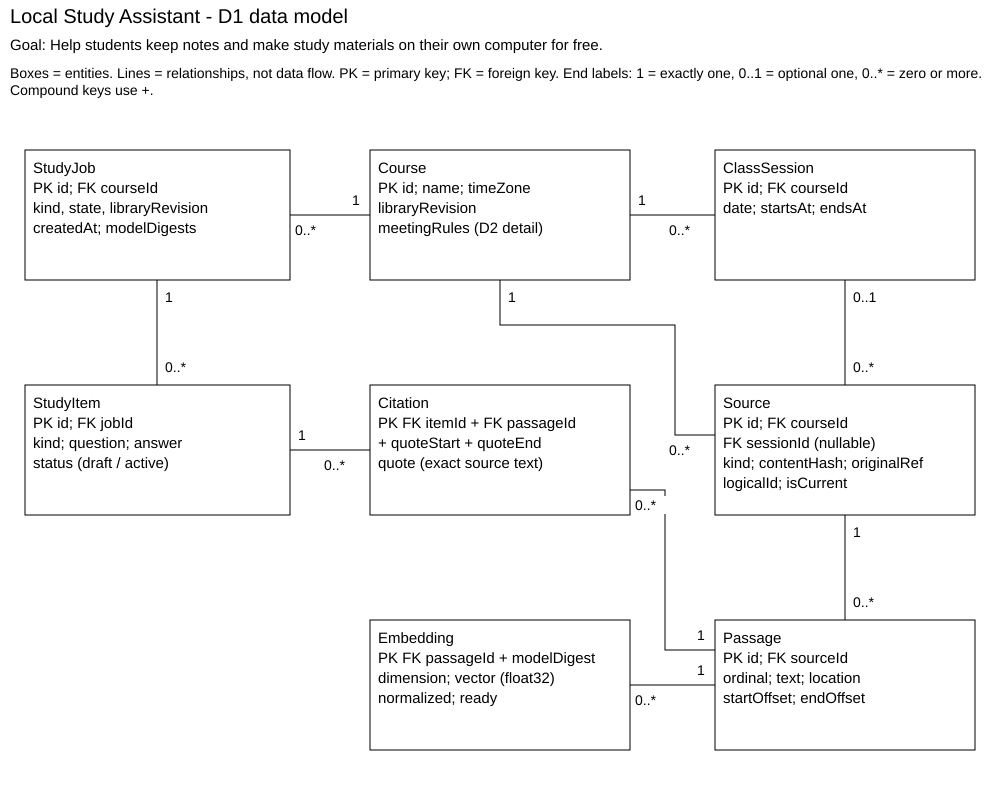

# D1 Detailed Design

## 1. Header, scope, and conventions

Local Study Assistant - Design D1 | Jason Galanie

Goal: Help students keep notes and make study materials on their own computer for free.

D1 details the local data store and study engine from D0; interface screens, calendar behavior, file import, full Ollama setup/adapter details, and quiz-review scheduling are deferred to D2.

This is a proposed detailed design, not a report of completed implementation. It keeps one course per item, optional meeting dates, local semantic search, direct source links, and background generation from our D0 decisions.

## 2. Data model, the D1 diagram



The relationship count beside a box tells how many of that entity may relate to one entity at the other end. Example: a session can have many sources, but each source has at most one session. This is a relational design; the searchable vectors are stored alongside source records.

## 2. Data model, the D1 diagram (continued)

| Structural decision | Reason / trace to D0 |
| --- | --- |
| Make sessions and sources separate entities. | One meeting can have several notes/files. A course-wide handout can have no session. Each source belongs to exactly one course. The store checks that a supplied session belongs to that course. US-05; I2/I4. |
| Keep passages separate from full files. | The engine needs a bounded piece of text with its original page/slide/note location. A source may have no passages if extraction failed. Offsets count Unicode characters; end is exclusive. US-01/02; I5. |
| Use Citation to connect items and passages. | One answer may use several passages; one passage may support several items. Citation is the many-to-many join. Ready drafts must have at least one valid citation, even though a new item may temporarily have none. US-01/02; I3/I4. |
| Keep embeddings by passage AND model digest. | Vectors from different embedding models cannot be compared safely. Store dimension and normalized float32 bytes, with a uniqueness key on (passageId, modelDigest). Replacing a model marks search unready until re-indexing. US-03; I5/I6. |
| Keep immutable source revisions. | Editing a note makes a new source ID under the same logicalId; isCurrent selects the latest revision. Old cited text stays available until explicit deletion. originalRef identifies saved text or a managed file. Removed evidence invalidates related items for practice. US-05; I4. |
| Store jobs independently of notes. | A failed AI job must not roll back saved notes. A job captures the course libraryRevision and model digests. If the library changes before completion, return STALE_LIBRARY rather than silently mixing versions. US-03/05; I3. |
| Use a relational store rather than one JSON file. | Foreign keys and transactions fit courses, sources, items, and citations. SQLite can update one note without rewriting all course history. JSON is still useful for small settings, not the main relationships. [1] |

Indexes: Source(courseId, sessionId, createdAt) finds course/meeting history; a unique partial index on Source(logicalId) WHERE isCurrent=1 keeps one active revision. Passage(sourceId, ordinal) is unique and preserves order; Embedding(modelDigest, passageId) selects one vector space; StudyJob(courseId, createdAt) finds recent jobs; StudyItem(jobId, status) returns drafts; Citation(passageId) finds affected items after deletion. Primary/compound keys are indexed too. I4/I5; US-01/02/05.

Session startsAt/endsAt are explicit UTC ISO 8601 timestamps; display dates and the course time zone are also retained. IDs are UUID strings. Source revisions, active source selection, and course.libraryRevision update in one short transaction. Session deletion leaves its sources course-wide; course deletion removes its content after explicit confirmation. Schedule-rule internals are deferred to D2.

## 3. Core algorithms

### A. Build and search the course memory

What / problem: RAG means the app stores and retrieves course material; the model does not permanently remember an upload. New source text is split into passages of at most 1,000 characters, with up to 100 characters of overlap inside the same page/slide/note. Keep the original location and offsets. Embed each passage once, normalize it, and store it under the model digest. Reuse unchanged passages. US-01/02/03; I5/I6.

Inputs / outputs: index input is SourceSection[] plus embeddingModelDigest: string. Output is IndexEntry[] with passageId: UUID, modelDigest: string, vector: float32[768] for the initial profile, and ready: boolean. A search takes courseId: UUID, query: string (1-300 characters), k: integer (1-32), and the digest; it returns RankedPassage[] {passageId: UUID, score: float in [-1,1], location: SourceLocation}. Other models need a new dimension/profile and full re-indexing.

## 3. Core algorithms (continued)

### A. Build and search the course memory (continued)

Steps / choice: prefix Nomic document text with search_document: and queries with search_query: [2]. Filter to the chosen course and current source revisions, then compare the normalized query vector with each eligible passage vector using a dot product. Keep the best k with the library top-k operation; ties use passageId. This exact search is the first implementation: it is easy to compare with known results and needs no extra vector server. Keyword-only search does not meet my semantic-search choice. An approximate index may help later, but its recall and added complexity need measurements first.

Complexity / scale: let N be passages in the selected course, d vector dimensions, and k the returned count. Exact search is O(Nd + N log k); block processing uses O(Bd + k) working memory for block size B=256, excluding stored data. Index creation costs O(T + E(T)) for T characters plus embedding-model work E, whose runtime must be measured. The API does not pretend neural inference has a fixed speed.

| Estimate, not a benchmark | Normal library | 100 times the material |
| --- | --- | --- |
| Selected course / whole app | 1,000 passages / 5,000 passages | 100,000 passages / 500,000 passages |
| One search at d=768 | 768,000 vector multiplications | 76,800,000 vector multiplications |
| Raw float32 vector bytes | 3.07 MB/course; 15.36 MB total | 307.2 MB/course; 1.536 GB total |
| Implication | Exact search is a reasonable prototype to measure. | Full re-indexing and scanning may be slow on a laptop. Stream blocks; measure before choosing an approximate index. Text, model memory, and DB overhead are extra. |

Edge cases: empty course -> EMPTY_LIBRARY; no vectors/current model -> INDEX_NOT_READY; missing model -> MODEL_UNAVAILABLE. Reject non-finite, zero-norm, or wrong-dimension vectors. A duplicate upload hash in the same course prompts the user before indexing again; repeated notes are not discarded. If a passage exceeds the model token limit despite the character bound, split again; disable silent truncation. All-course search excludes other courses. Deleted sources and model changes invalidate the affected index entries.

### B. Generate study items and check their source links

What / problem: turn retrieved text into usable drafts without losing the evidence needed to open an exact source. Inputs are a study request {courseId: UUID, kind: recap|guide|flashcard|quiz, count: integer 1-20, topic: string or null}, a ready course index, and model profiles. Output is JobResult {items: StudyItem[], coveredSourceIds: UUID[], warnings: string[]}; failed tasks return a named error. US-01/02/03/05; I3/I5/I6.

Steps / choice: capture libraryRevision. For a topic request, retrieve its best passages. For a general course request, take representative prompts from up to eight meetings/source groups spread across the course dates and retrieve for each; include course-wide sources as a group. Remove duplicate passage IDs and pack at most 8,000 source characters with IDs/locations. Ask for structured drafts in batches of at most eight items, never more than 20 total. Require references to supplied passages and exact quote spans; check those against stored originals. Reject unknown references, empty answers, and duplicate questions. Save checked drafts/citations together only if libraryRevision still matches. Return coverage/warnings so a short quiz is never described as complete exam coverage.

Complexity / edge cases: up to q=8 searches give O(q(Nd+N log k)); q is capped. For J<=20 candidates, r<=8 references each, and passage length L<=1,000, quote checking is O(JrL), plus model inference time. At 100x the library, retrieval work scales roughly 100x; bounded validation stays similar. Original notes remain untouched. Allow one retry per model batch; timeout or invalid output then fails that batch with a warning. No valid drafts -> NO_SUPPORTED_ITEMS. Cancellation, missing/deleted evidence, or a changed library stops final publication. A matching quote proves provenance, not that an answer is logically correct; students review drafts. This is preferred over blindly saving model output or treating a whole-course prompt as memory.

## 4. Build-versus-reuse decisions

These are working choices for the design, not a claim that the dependencies have already been integrated. Exact versions and model digests will be pinned before implementation. License checks use the upstream sources listed in part 6.

| Piece | Build / reuse | Library / license | Maturity, performance, and fit |
| --- | --- | --- | --- |
| Courses, source revisions, source links | Build | Project code; app license still to be selected. | Specific to this app. Enforce course ownership and preserve original text. |
| Relational storage and transactions | Reuse | SQLite + Python sqlite3; public domain / PSF terms. [1,3] | Established local storage, no server. Use short transactions and per-worker connections; benchmark save contention. |
| Embedding inference | Reuse | Ollama (MIT); Nomic embed-text candidate (Apache-2.0). [2,4] | Documented local embedding API. Extra model download is accepted; measure index speed and verify dimension/digest at setup. |
| Vector math / ranking | Reuse + build course filtering | NumPy (BSD-3-Clause); Python heapq (PSF). [3,5] | Established array math and top-k primitives. Exact block scan avoids another service; linear scanning can be a large-library bottleneck. |
| Prompt selection, source checking | Build | Project code. | This is the project-specific evidence pipeline. Reuse libraries for parsing; do not trust generated references automatically. |
| Text generation | Reuse | Ollama (MIT); Qwen3-4B candidate (Apache-2.0). [4,6] | Local JSON-capable generation. Candidate for the demo, not a proven default for every laptop; measure quality/latency. |
| Jobs / dates / sorting | Reuse | Python concurrent.futures, datetime, zoneinfo, sorted, heapq (PSF); tzdata package uses Apache-2.0 code with public-domain time-zone data. [3] | Standard primitives avoid custom parsers and sorting. Use a worker for model I/O; do not block the UI or hold a DB transaction during inference. |
| Desktop display / packaging | Reuse | pywebview (BSD-3-Clause); PyInstaller (GPL with bundling exception). [7,8] | Keeps HTML/CSS/JS and Python together. New tools to test on a clean Windows machine; dependency licenses still apply to the bundle. |
| File extraction (D2 integration) | Reuse | pypdf (BSD-3-Clause); python-pptx (MIT). [9] | Established text-readable PDF/PPTX tools. Image-only files still need a separate OCR decision; preserve extraction locations. |
| Accounts / authentication | Do not build | Single-user local app; operating-system account. | No login/password service or custom authentication. Restrict the bridge to trusted app pages; external/network access is outside this design. |

Build/reuse boundary: the data model, course-scoped retrieval policy, source-link checks, and job state handling belong to the app. Model inference, database transactions, numeric operations, date/time conversion, and sorting come from maintained tools. Reusing a tool does not remove the need to test its behavior on the target machine.

## 5. API contract

These are v1 internal Python methods, reached through the trusted desktop bridge where needed. They refine D0 I3-I6; they are not new public HTTP endpoints. R = required, O = optional. IDs are UUID strings; null means absent. All methods return the Result envelope defined on the next page. No implicit success/null response is allowed.

| Method / D0 interface | Inputs, valid ranges | Success data | Error codes / when |
| --- | --- | --- | --- |
| save_note / I4 | courseId: UUID R; sessionId: UUID|null O (default null); title: string R, 1-120 chars; text: string R, 1-100,000 chars. | NoteRecord. New immutable source ID and course revision. | INVALID_INPUT; NOT_FOUND for course/session; COURSE_MISMATCH; STORAGE_ERROR. |
| submit_task / I3 | courseId: UUID R; kind: enum(index, recap, guide, flashcard, quiz) R; count: int O, 1-20, default 10 (ignored for index/recap/guide); topic: string|null O, 1-300 chars or null. | JobSnapshot, initially queued; items=[]; coveredSourceIds=[]; warnings=[]. | EMPTY_LIBRARY; INDEX_NOT_READY for study; MODEL_UNAVAILABLE; BUSY if a job for this course is queued/running; INVALID_INPUT. |
| get_job / I3 | jobId: UUID R. Read-only; safe to repeat. | JobSnapshot with current state/results. Poll at most once per second. | NOT_FOUND; STORAGE_ERROR. Late job failures appear in job.error, not as a fake successful draft list. |
| search_evidence / I5 (engine only) | courseId: UUID R; modelDigest: string R, 1-128 chars; vector: finite float[768] R for current profile, unit norm within 0.001; k: int O, 1-32, default 8. | {matches: RankedPassage[], libraryRevision: int >=0}. | INVALID_INPUT; INDEX_NOT_READY; MODEL_MISMATCH; NOT_FOUND. Every returned passage must belong to courseId. |
| resolve_reference / I4 | itemId: UUID R; referenceIndex: int R, 0-7 and less than that item's stored reference count. | SourceView. Opens only the stored managed source/known location. | NOT_FOUND; SOURCE_GONE; INVALID_INPUT. Never accept an arbitrary external path from the model. |
| accept_item / I4 | itemId: UUID R. Repeating an already accepted item is allowed. | {itemId: UUID, status: string(active)}. | NOT_FOUND; SOURCE_GONE; INVALID_INPUT if not a checked draft. Recheck references before activation. |

Storage operations validate types, IDs, length limits, and course/session ownership before writing. Failed writes roll back. save_note creates one passage for a short note or schedules passage splitting for a long note; the new source is not searchable until its index is ready. Imports enter the same source pipeline through the D2 importer. No authentication tokens or student grades are part of these methods.

## 5. API contract (continued)

Exact shared shapes (strings are UTF-8; timestamps are ISO 8601 UTC strings):

```text
Error = {code:string, message:string, retryable:boolean}
Result<T> = {ok:true, data:T, error:null}
         | {ok:false, data:null,
            error:{code:string, message:string, retryable:boolean}}
NoteRecord = {sourceId:UUID, courseId:UUID, sessionId:UUID|null,
              title:string, text:string, createdAt:string,
              libraryRevision:integer}
JobSnapshot = {job:{id:UUID, courseId:UUID, kind:string,
               state:"queued"|"running"|"done"|"failed",
               completedUnits:integer, totalUnits:integer,
               createdAt:string, error:Error|null},
               items:StudyItem[], coveredSourceIds:UUID[],
               warnings:string[]}
StudyItem = {id:UUID, kind:string, question:string, answer:string,
             status:"draft"|"active", references:Reference[]}
Reference = {passageId:UUID, sourceId:UUID, type:"page"|"slide"|"note",
             pageOrSlide:integer|null, noteId:UUID|null,
             quoteStart:integer, quoteEnd:integer, quote:string}
RankedPassage = {passageId:UUID, score:number, text:string,
                reference:Reference}
SourceView = {sourceId:UUID, title:string, type:"page"|"slide"|"note",
              pageOrSlide:integer|null, noteId:UUID|null,
              text:string, managedFileId:UUID|null}
```

Bounds: job progress counts finished/total work units, both integers >=0; totalUnits=0 means not estimated yet. Items <=20; references per item 1-8; question 0-500 characters (empty for recap/guide); answer 1-2,000; quote 1-1,000. Page/slide numbers start at 1. quoteStart/quoteEnd are character offsets in the immutable passage [start,end), and quote must equal that slice. SourceView.text is the selected page/slide/note text, not the whole course. RankedPassage.score is cosine similarity in [-1,1].

Example submit_task request and successful queued response:

```text
REQUEST
{"courseId":"f283bdf3-8905-4ded-a46c-7f09fd25da61",
 "kind":"flashcard", "count":10, "topic":null}
RESPONSE
{"ok":true,"data":{
 "job":{"id":"3755a7a8-724a-4a55-ad30-ea77f04015c8",
 "courseId":"f283bdf3-8905-4ded-a46c-7f09fd25da61",
 "kind":"flashcard","state":"queued",
 "completedUnits":0,"totalUnits":0,
 "createdAt":"2026-10-28T23:00:00Z","error":null},
 "items":[],"coveredSourceIds":[],"warnings":[]},"error":null}
```

Retry policy: MODEL_UNAVAILABLE, TIMEOUT, INDEX_NOT_READY, BUSY, INTERRUPTED, and STORAGE_ERROR may be retryable after the cause is fixed. INVALID_INPUT, COURSE_MISMATCH, NOT_FOUND, MODEL_MISMATCH, SOURCE_GONE, and NO_SUPPORTED_ITEMS require a changed request or data. A changed library returns STALE_LIBRARY and offers a new job. On app restart, unfinished jobs become failed/INTERRUPTED; saved notes remain. Error messages explain the next action.

Versioning: version the internal bridge contract as v1 and the database with numbered migrations; a removed/renamed field, changed type/units, stricter accepted range, or changed meaning is breaking and requires v2 plus an explicit migration/adapter. Additive optional fields may stay in v1.

## 6. Technology choices with justification

These are proposed working choices for review. Python, SQLite, and HTML/CSS/JavaScript are acceptable to me, and they are present in the prototype. Semantic retrieval and desktop packaging are new work to learn and test; I am not claiming prior experience with every library.

### Database - SQLite

Skill fit: it matches the current prototype and a small relational model. Licensing: SQLite is public domain. Community/support: it has established first-party documentation and Python support. Performance: indexes and short transactions suit local course records; vector scans still need measurements. Cost/hosting: no paid database or server process. I passed over PostgreSQL because its separate server is unnecessary for one student. [1,3]

### Backend - Python with library methods and a background worker

Skill fit: Python is acceptable to me and already runs the prototype. Licensing: Python uses PSF terms, with dependency notices retained. Community/support: standard documentation covers SQLite, workers, dates, and sorting. Performance: NumPy handles vector blocks; model I/O runs off the UI thread with separate DB connections. Cost/hosting: it runs locally without an API bill. I passed over a Node-only backend to avoid rewriting the existing Python workflow. [3,5]

### Front end and desktop - HTML/CSS/JavaScript in pywebview

Skill fit: the web tools are acceptable to me and match the course-tab idea; pywebview itself is a new tool to evaluate. Licensing: pywebview is BSD-3-Clause; Windows web-runtime terms also need packaging review. Community/support: its project documents the Python/JS bridge and desktop engines. Performance: it reuses a system webview, but startup, keyboard access, and screen readers need real-device tests. Cost/hosting: no hosted site is needed. Electron is an alternative, but it adds a bundled browser/runtime to this Python-based project. [7]

### Model platform and messaging - local Ollama

Skill fit: the prototype already calls Ollama; embeddings are new work. Licensing: Ollama is MIT, and the proposed Nomic embed-text and Qwen3-4B weights use Apache-2.0 upstream; record the actual packaged artifacts and notices. Community/support: first-party APIs/model cards document the inputs. Performance: use the 768-dimensional Nomic profile initially and evaluate Qwen3-4B for quality and latency; no laptop-fit claim is made yet. Cost/hosting: downloaded models run locally. A paid cloud model would weaken the no-required-subscription goal. [2,4,6]

### Hosting, distribution, and jobs - one local Windows app

Skill fit: Windows is the first target; packaging is new work. Licensing: PyInstaller has a bundling exception, while app/dependency licenses still apply. Community/support: upstream packaging guidance is available. Performance: queue model work and keep note transactions short; show progress and retry instructions. Cost/hosting: the app needs download space and the student's hardware, not a hosted backend. A cloud queue is unnecessary; local work uses Python's worker tools. [3,8]

Source key (first-party documentation and license files, checked for this draft):

- [1 SQLite](https://www.sqlite.org/whentouse.html); [additional source](https://www.sqlite.org/copyright.html)
- [2 Nomic model/prefixes](https://huggingface.co/nomic-ai/nomic-embed-text-v1.5); [additional source](https://ollama.com/library/nomic-embed-text)
- [3 Python](https://docs.python.org/3/license.html); [additional source](https://docs.python.org/3/library/zoneinfo.html)
- [4 Ollama](https://docs.ollama.com/api/embed); [additional source](https://github.com/ollama/ollama/blob/main/LICENSE)
- [5 NumPy](https://github.com/numpy/numpy/blob/main/LICENSE.txt); [additional source](https://docs.python.org/3/library/heapq.html)
- [6 Qwen](https://huggingface.co/Qwen/Qwen3-4B); [additional source](https://ollama.com/library/qwen3:4b)
- [7 pywebview](https://pywebview.flowrl.com/guide/architecture.html); [additional source](https://github.com/r0x0r/pywebview/blob/master/LICENSE)
- [8 Packaging](https://pyinstaller.org/en/stable/license.html)
- [9 Extractors](https://github.com/py-pdf/pypdf/blob/main/LICENSE); [additional source](https://github.com/scanny/python-pptx/blob/master/LICENSE)