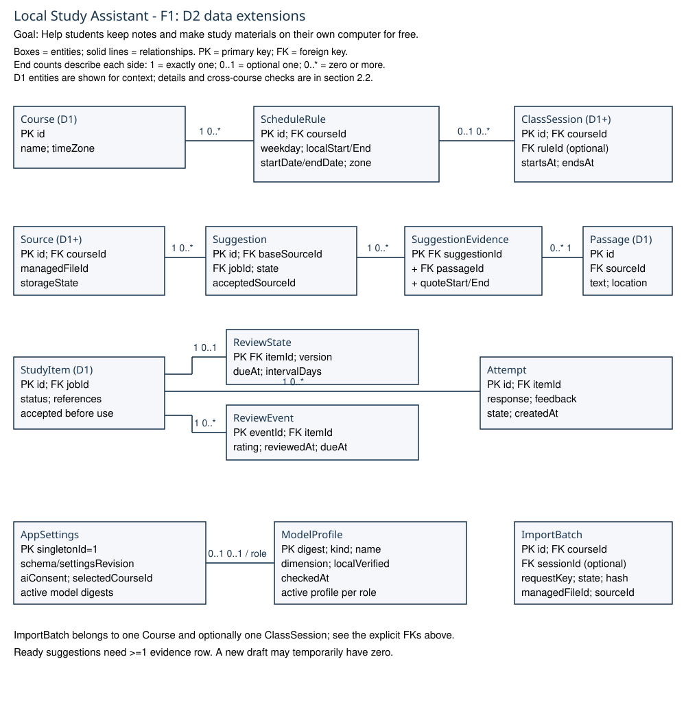
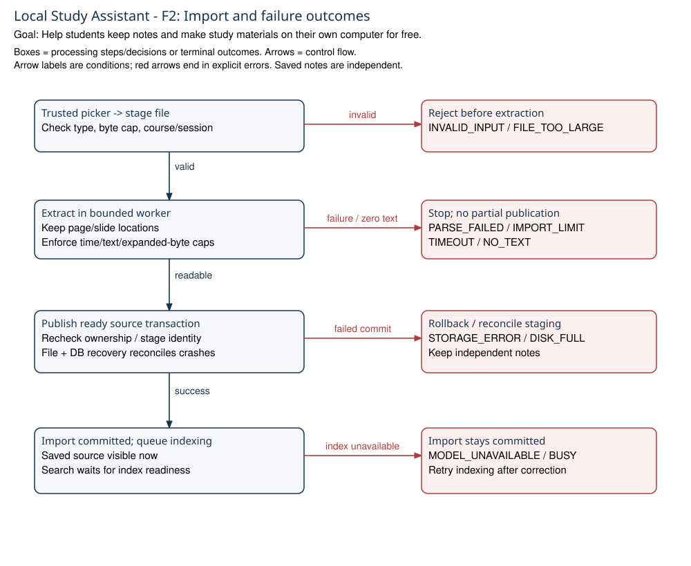
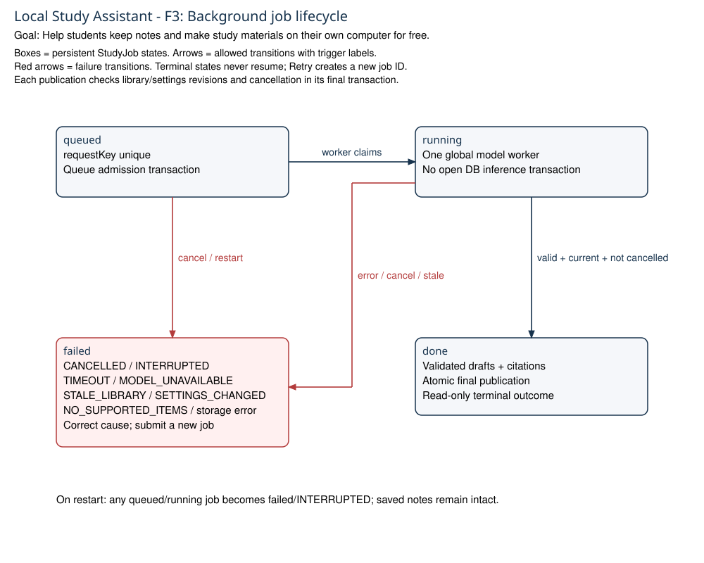

# D2 Detailed Design

Local Study Assistant | Team: Local Agent Systems | Team member: Jason Galanie

## 1. Header, conventions, and D2 overview

Goal: Help students keep notes and make study materials on their own computer for free.

I am designing a single-user Windows app for keeping course notes beside readable slides and turning that material into source-linked practice. Notes save locally before any model work starts. The student reviews AI drafts before using them. A model failure leaves capture and saved material available.

D1 specified my relational store, immutable source revisions, passage embeddings, exact course-scoped retrieval, checked study drafts, and the v1 bridge result shapes. In D2 I finish the desktop interface, course/calendar workspace, importer, Ollama adapter, lecture assistance, and practice lifecycle. I also define the access boundary, notifications, configuration, logging, recovery, and deletion behavior. I revisit the D1 store and engine wherever these finished components require an extension. Sections 2 and 3 are proposed implementation specifications, not claims that these features already work in the prototype.

I own all components as the sole team member. My earlier prototype is a local web app; this design targets the desktop bridge proposed in D1. The existing User_Stories document is the functional baseline. I assign additional FR and NFR IDs in section 4 to make the later D0 choices and project-plan constraints traceable; these are design-derived requirements, not new interview findings.

Known gaps: I have not received the actual peer-review notes for this document, so section 6 records that evidence as pending. I still need to review and explain the proposed edge-case analysis, traceability, and rationale myself. Model quality, latency, accessibility, clean-machine packaging, and the advisor's approval of the project pivot remain unvalidated. No measured performance or completed peer review is claimed. OCR, LMS integration, cloud sync, automatic grading, and multi-user access remain outside this design. An unreadable image-only slide is handled as an explicit limitation, not deferred error handling.

Figure conventions: F1 uses entity boxes with PK and FK labels; solid lines are relationships with multiplicity at both ends. F2 uses rounded process boxes, decision boxes, and labeled directed arrows; red arrows lead to failure outcomes. F3 uses state boxes and directed transitions labeled with their triggers; red transitions fail a job. A figure's title, goal, and legend appear inside each figure. Cardinalities 1, 0..1, and 0..* mean exactly one, optional one, and zero or more. Fields shown are behavioral keys, not a complete physical schema.

## 2. Finished components, the D2 diagrams

### 2.1 Component audit and shared contract

| ID / D0 box | Persistent data / design location | Defined behavior and interface | Edge-case coverage |
| --- | --- | --- | --- |
| C1 Desktop interface | No persistent data; transient ViewState and unsaved buffer; section 2.3 | dispatch, source navigation, keyboard/focus flow; I1 | E01-E04 |
| C2 Course workspace | Course, ScheduleRule, ClassSession; F1, section 2.4 | calendar expansion, selected-course coordination; I1/I4 | E05-E08 |
| C3 Material importer | ImportBatch and staged managed file; F1/F2, section 2.5 | bounded extraction, atomic publication; I2/I4 | E09-E12 |
| C4 Study engine | D1 StudyJob/StudyItem/Citation plus requestKey; F3, section 2.6 | D1 algorithms A/B, job recovery and cancellation; I3/I5 | E13-E16 |
| C5 Ollama connection | No independent persistent data; configured profiles in C9; section 2.7 | bounded embed/generate, no automatic remote fallback; I6/I7 | E17-E20 |
| C6 Local data store | D1 entities plus F1 extensions, schemaVersion and deletion state; section 2.8 | transactions, revision checks, managed-file recovery; I4/I5 | E21-E24 |
| C7 Access boundary (glue) | No persistent data; OS account is the identity boundary; section 2.9 | trusted local-page bridge guard | E25-E28 |
| C8 Notifications (glue) | No persistent data; derive status from jobs/reviews; section 2.10 | in-app status and accessible announcements | E29-E32 |
| C9 Configuration/setup (glue) | AppSettings, ModelProfile; F1, section 2.11 | validated settings, model readiness, packaging checks | E33-E36 |
| C10 Logging (glue) | bounded local metadata log; section 2.12 | redact, rotate, degrade without blocking saves | E37-E40 |
| C11 Practice/review (within workspace) | ReviewState, ReviewEvent, Attempt; F1, section 2.13 | reveal, formative feedback, self-rating schedule; I1/I3/I4 | E41-E44 |
| C12 Lecture assistance (within engine) | Suggestion, SuggestionEvidence; F1, section 2.14 | compare note with selected slides, accept as revision; I3/I4 | E45-E48 |
| External Ollama + local models | Downloaded weights and runtime owned by Ollama | C5 is my integration boundary, not a second implementation of the runtime | E17-E20 |

Shared contract: I retain D1 Result<T> = {ok:true,data:T,error:null} or {ok:false,data:null,error:{code:string,message:string,retryable:boolean}}. All methods below return this envelope. R means required; O means optional. All IDs are UUID strings, timestamps are UTC ISO 8601 strings, dates are YYYY-MM-DD, and local times are HH:mm. Date parsing and time-zone conversion use Python datetime/zoneinfo, not a custom parser. Numeric bounds are inclusive. Any omitted field defaults only where specified. Unknown fields and incorrect JSON types return INVALID_INPUT. Strings are Unicode; character offsets count code points, with end exclusive.

All signatures in sections 2.3-2.14 name the required fields. Lists have explicit caps. An error stops the operation before success is reported. STORAGE_ERROR means a failed transaction or unreadable local data; INVALID_INPUT means a bad type/range; NOT_FOUND means a missing identified record. Transient dependency failures can be retried after the cause is fixed. Permission failures and bad input require a correction first. A failed asynchronous operation appears in its saved job.error using the same error shape.

### 2.2 Data extensions and figure sources



F1 extends D1; it does not replace the D1 ER diagram. Existing Course, ClassSession, Source, StudyItem, Passage, and StudyJob remain as defined there. Each source and session belongs to one course. A session has an optional scheduleRuleId because manually created meetings need no recurring rule. A rule has zero or more sessions. A source has zero or more suggestions based on that immutable note revision; a suggestion has one or more evidence rows before it is ready to accept.

| New entity / key fields | Constraint and lookup |
| --- | --- |
| ScheduleRule: PK id; FK courseId; weekday 0-6 (Monday=0); localStart/localEnd; startDate/endDate; timeZone; revision integer >=0 | Unique (courseId, weekday, localStart, localEnd, startDate, endDate, timeZone). LocalEnd > localStart; cross-midnight meetings are not accepted in v1. |
| ClassSession extension: optional FK scheduleRuleId; scheduleRevision integer >=0 | Unique (scheduleRuleId,date) when rule is present. Check UTC endsAt > startsAt. Index (courseId,startsAt,endsAt). Preserve sessions referenced by sources when editing a rule. |
| ImportBatch: PK id; FK courseId; optional FK sessionId; requestKey UUID; sourceId UUID or null; kind; state; byteCount; hash; managedFileId UUID or null; errorCode or null | Unique requestKey; states staged, extracting, committed, failed. Job recovery reconciles staged files with committed Source rows. Index (state,createdAt). |
| Suggestion: PK id; FK baseSourceId; FK jobId; text 1-100,000 chars; additions JSON (typed list in 2.14); state draft/accepted/dismissed; acceptedSourceId UUID or null | Unique acceptedSourceId when non-null. New source revision records its predecessor; the original note is never overwritten. Index (baseSourceId,state). |
| SuggestionEvidence: PK (suggestionId,passageId,quoteStart,quoteEnd); FKs suggestionId/passageId; exact quote | Many-to-many join. Check quote equals the immutable passage slice and belongs to the selected course/slide set. Index passageId for invalidation. |
| ReviewState: PK FK itemId; dueAt UTC; intervalDays integer 0-30; version integer >=0 | One active flashcard has one state. Index (dueAt,itemId) for due selection; active status is checked with StudyItem. |
| ReviewEvent: PK eventId; FK itemId; rating again/good; reviewedAt; intervalDays; dueAt | Immutable history. Unique eventId makes a retried rating idempotent. Index (itemId,reviewedAt). |
| Attempt: PK id; FK itemId; response 0-2,000 chars; feedback 0-2,000 chars or null; createdAt; state pending/ready/failed | One item has many attempts. Keep an answer local; generated feedback is formative and always shows the accepted expected answer and references. |
| AppSettings: PK singletonId=1; schemaVersion; selectedCourseId UUID or null; embeddingDigest/generationDigest optional FKs; lastBackupAt UTC or null; aiConsent boolean | One installation, not an account. File root is app-owned and cannot be supplied by the model. Settings and model profiles live in SQLite for transactional updates. |
| ModelProfile: PK digest; name; kind embed/generate; dimension integer or null; localVerified boolean; checkedAt UTC or null | D1 Embedding references the active embedding digest. Dimension is 768 for the initial profile; generation dimension is null. Installing a new digest invalidates readiness until checked. |

Source gains createdAt, title, mediaType, and managedFileId where appropriate; these complete fields already used by the D1 interfaces/indexes. Library revisions change atomically on content changes. StudyJob gains requestKey UUID UNIQUE and settingsRevision integer. Review/suggestion data is removed or made unusable when its source evidence is removed, as detailed in section 2.8.

### 2.3 C1: Desktop interface and source navigation

Data: no persistent data. ViewState = {courseId:UUID|null, sessionId:UUID|null, screen:course|capture|study|practice|setup, selectedItemId:UUID|null, buffer:string, pending:boolean, focusId:string|null}. The note buffer is 0-100,000 characters in memory; a failed save keeps it until the student copies, saves, or explicitly discards it. The app does not promise recovery of an unsaved buffer after an OS crash.

Behavior: (1) load course summaries, (2) require a selected course before a new save/import/study request, (3) validate bounded input, (4) send one named request, (5) render the saved result or retain input on failure. Disable only the submitting control. Associate responses with their original course and request ID; a late result never changes the newly selected course. Ask Save/Discard/Cancel before closing a dirty view. Treat all source/model text as text, not executable HTML. Source navigation resolves only saved managed IDs, opens the exact page/slide/note, and restores focus to the invoking study item on return.

I1 becomes a small typed method set rather than D0's generic operation/data bag: dispatch(command:Command R) -> the result of the selected method below. Command has exactly one kind (saveNote, importFile, submitStudy, getJob, openSource, changeCourse, practice, setup) and that method's named payload. The UI cannot call SQL or send a filesystem path from model output. openSource(itemId:UUID R, referenceIndex:int R 0-7) returns the D1 SourceView, with NOT_FOUND, SOURCE_GONE, INVALID_INPUT, or ACCESS_DENIED. SourceView is an exact location and source text; a file viewer consumes managedFileId, not an arbitrary path.

Accessibility: native labels, logical tab order, visible focus, text errors connected to fields, and an aria-live status region. The whole practice -> reveal -> source -> return flow must work with keyboard and a screen reader. Status polling is at most once a second and does not steal focus. A screen-reader test remains an acceptance activity, not a completed result. Relevant handlers: UIErrorPresenter and NavigationGuard.

### 2.4 C2: Course workspace and calendar

Data: Course and ClassSession from D1 plus ScheduleRule in F1. The selected course is saved in AppSettings. Meeting dates are optional for sources. I use the D0 one-course rule for saved material; the older prototype's unclassified inbox is not the D2 storage rule. I require course selection at save time rather than silently changing an earlier saved item's ownership.

Algorithm: validate course and rule; expand the inclusive date range (at most 366 days) by weekday; construct local start/end using the named IANA time zone; round-trip candidate instants through UTC. A nonexistent local time returns NONEXISTENT_TIME; an ambiguous local time returns AMBIGUOUS_TIME and requires the student to choose an offset for that occurrence. That explicit occurrence is saved as a manual session. Never silently shift the meeting. Store both the local date and UTC start/end. Rule updates replace only unused future sessions; preserve any session already linked to a source. If simultaneous courses overlap, show both as suggestions and let the student choose. Never auto-move a note.

Complexity: with D <=366 days per rule and R rules, expansion costs O(RD), then O(S log S) library sorting for S sessions. At five courses with two rules each this is <=3,660 day checks per expansion; at 100 times that, <=366,000. This may increase load time; generate only the requested term, measure, and cache by rule revision. Active-course lookup uses the session time index and returns every overlap, ordered by start time then ID.

Methods: createCourse(name:string R 1-80) -> {courseId:UUID,name:string}; DUPLICATE_NAME or INVALID_INPUT/STORAGE_ERROR. saveRule(courseId:UUID R, rule:RuleInput R, expectedRevision:int R >=0) -> {ruleId:UUID,revision:int>=0,sessionsCreated:int>=0}; NOT_FOUND, VERSION_CONFLICT, INVALID_INPUT, AMBIGUOUS_TIME, NONEXISTENT_TIME, STORAGE_ERROR. RuleInput has weekday:int 0-6, localStart/localEnd:HH:mm, startDate/endDate:date, timeZone:string 1-64. Each range is <=366 days; <=14 active rules per course. listSessions(courseId:UUID R, from:UTC R, to:UTC R, cursor:UUID|null O default null, limit:int O 1-100 default 50) -> {sessions:Session[],nextCursor:UUID|null}; Session={id,courseId:UUID,date:date,startsAt,endsAt:UTC}; INVALID_INPUT, NOT_FOUND, STORAGE_ERROR. End-exclusive time filtering uses startsAt < to and endsAt > from. Handlers: CalendarValidator and WorkspaceCoordinator.

### 2.5 C3: Material importer



Data: ImportBatch and a randomly named staging file. Accept readable .txt/.md, .pdf, and .pptx; reject other extensions including macro-enabled slides. Verify file content matches the parser, not only its extension. Limits: 20 MiB input, 500 pages/slides, 1,000,000 extracted characters per file, 60 seconds extraction wall time, and 200 MiB total uncompressed PPTX entries. These are initial resource limits to validate on demo hardware. Exceeding a limit stops extraction without partial publication. I reuse pypdf/python-pptx and Python decoding instead of building parsers.

Steps: validate course/session and consent; copy from the trusted file picker to staging; hash bytes; detect an existing current source hash in the same course; if duplicate, return its ID and request confirmation before re-import. Extract in an isolated worker process so a timeout can stop it. Preserve 1-based page/slide numbers and paragraph order. Skip empty sections with warnings. Zero readable sections returns NO_TEXT and retains independently saved notes. Never infer slide details from empty text. On success publish all Source/Passage metadata in one transaction and rename the staged managed file using the recovery protocol in 2.8. Indexing starts afterward and has its own job; model unavailability does not undo import. F2 shows the decided failure branches.

I2: importFile({requestKey:UUID R,courseId:UUID R,sessionId:UUID|null O default null,fileToken:UUID R,confirmDuplicate:boolean O default false}) -> {batchId:UUID,sourceId:UUID|null,state:staged|extracting|committed|failed,existingSourceId:UUID|null,warnings:string[]}. fileToken is minted by the trusted picker, expires after 10 minutes, and cannot name an arbitrary path. Requests for the same requestKey return the existing batch, including failed state. Poll importStatus(batchId:UUID R) -> same shape plus error:Error|null. Submission errors: INVALID_INPUT, NOT_FOUND, COURSE_MISMATCH, FILE_TOO_LARGE, UNSUPPORTED_TYPE, ACCESS_DENIED, BUSY. Asynchronous errors: NO_TEXT, DUPLICATE_SOURCE, PARSE_FAILED, IMPORT_LIMIT, TIMEOUT, STORAGE_ERROR, INTERRUPTED. A fresh requestKey after correction starts a new attempt.

Complexity: extraction is parser-dependent; enforce byte/expanded-byte/section/time bounds rather than claiming all PDFs are linear. Hashing is O(B) bytes. TXT splitting is O(T) characters. Staging and extracted text use disk plus bounded worker memory; process termination handles parser overrun. At 100x the normal input the same per-file limits reject rather than freeze. Handler: ImportSupervisor.

### 2.6 C4: Study engine, jobs, and recovery



Data and algorithms: retain D1 Course/Source/Passage/Embedding/StudyJob/StudyItem/Citation, exact block cosine retrieval, and quote-span checking. D2 completes lifecycle rules. One global model worker serializes inference; at most one queued/running job per course and four queued jobs across the app. A queue admission transaction enforces both limits. No transaction stays open during inference. Import extraction uses a separate process and does not consume the model worker.

Admission captures libraryRevision, settingsRevision, requestKey, and model digests. The same requestKey returns the same job rather than generating duplicates. Execution reads only current sources in that course and rechecks revisions immediately before publishing items and citations in one transaction. An edited or deleted source returns STALE_LIBRARY; a profile change returns SETTINGS_CHANGED. Retrying either creates a fresh job with a new requestKey, so the student sees what was retried.

F3 keeps D1's queued/running/done/failed states. cancelJob marks queued work failed/CANCELLED or requests a running worker to stop; its final publication transaction checks cancellation. Completed results remain done. A blocked inference connection is closed at its timeout; the job is not resubmitted automatically. Restart marks unfinished jobs failed/INTERRUPTED and leaves saved notes intact. Drafts publish only at the end; partial candidates are not silently accepted. The one batch retry allowed in D1 applies only to retryable model errors/invalid output, with one-second backoff, and never exceeds two attempts per batch.

I3 extends D1 submit_task with requestKey:UUID R; returns the unchanged JobSnapshot envelope. cancelJob(jobId:UUID R) -> {jobId:UUID,state:queued|running|done|failed,cancelRequested:boolean}; NOT_FOUND or STORAGE_ERROR. Existing get_job(jobId) remains v1. Additive requestKey is provided by a compatibility wrapper for older internal callers; no external clients are deployed. Explicit new methods carry this field, and a future incompatible removal requires v2 as D1 specifies. Named errors include EMPTY_LIBRARY, INDEX_NOT_READY, BUSY, MODEL_UNAVAILABLE, NO_SUPPORTED_ITEMS, STALE_LIBRARY, SETTINGS_CHANGED, TIMEOUT, CANCELLED, INTERRUPTED. A failed job is not retried by polling. Handler: JobSupervisor. D1's normal/100x analysis remains the sizing basis.

### 2.7 C5: Ollama adapter and external runtime

Data: no persistent data owned here; use the verified ModelProfile records from C9. Behavior: (1) validate the requested digest/profile and local-only policy, (2) build bounded JSON from engine inputs, (3) POST to exactly http://127.0.0.1:11434 with no proxy or redirect following, (4) enforce connect timeout 3 seconds and total request deadline 60 seconds, (5) cap response bytes at 8 MiB, (6) decode/validate, and (7) return typed data or a named error. Cancellation closes the request; the runtime may finish computing, but the app discards its result.

I6 uses separate methods rather than D0's optional vector/text fields: embed(profileDigest:string R 1-128,texts:string[] R 1-32 entries,each 1-1,000 chars) -> {digest:string,vectors:float32[768][]}; generate(profileDigest:string R 1-128,prompt:string R 1-12,000 chars) -> {digest:string,text:string 1-100,000}. The engine's evidence portion stays <=8,000 characters; instructions must also fit the prompt cap. A character cap is not a token guarantee: context overflow returns CONTEXT_LIMIT and the engine reduces input or reports it. Do not truncate evidence silently.

I7 embed sends {model:string,input:string[],truncate:false}; validate exactly one finite 768-element vector per input and normalize in the D1 engine. I7 generate sends {model:string,prompt:string,stream:false,format:"json"}; require done=true and parse response:string as bounded structured output. Ollama's official APIs document these fields [S1,S2]. Unknown response fields are ignored; required fields and bounds are strict. Errors: MODEL_UNAVAILABLE (refused/not installed), MODEL_MISMATCH, TIMEOUT, CONTEXT_LIMIT, RESPONSE_LIMIT, INVALID_MODEL_OUTPUT, LOCAL_POLICY, and CANCELLED. HTTP 5xx is eligible for the engine's one retry; 4xx/context errors require a corrected request. Handler: OllamaAdapter.

Loopback alone does not prove inference is local: Ollama can use cloud models through its local installation [S3]. Setup therefore accepts only installed local model profiles whose artifacts and digest have been checked, rejects known remote profiles, and requires an offline smoke test before marking a profile locally verified. If locality cannot be established, generation stays disabled; notes/manual practice continue. There is no cloud fallback, sign-in prompt, paid key, or model-supplied URL in my adapter. The locally installed runtime is a trusted dependency, not protection against a compromised OS/runtime.

### 2.8 C6: Local store, deletion, export, and migration

Data: D1 relational entities plus F1, schemaVersion, and Source.storageState staging|ready|deleting. Enable foreign keys on every connection; use per-worker connections, short transactions, WAL mode and a 2-second busy timeout. Immutable source revisions preserve old cited text until explicit deletion. Publish only ready sources to browsing, indexing, and generation.

File publication protocol: (1) commit Source/Passage metadata in staging state linked to its ImportBatch; (2) atomically rename the checked staging file to its generated managed-file path on the same volume; (3) in a new transaction mark the source ready, the batch committed, and increment the course library revision; then queue indexing. A crash between these steps leaves no partially visible source. ManagedFileRecovery checks the stored hash and generated IDs; if the final file exists it finishes step 3, and if only the matching staging file exists it finishes steps 2-3. If neither valid copy exists, it marks the batch failed and removes unpublished metadata. Orphan staging files with no committed row are removed on startup after checking their app-owned paths. File and database operations are deliberately reconciled rather than described as one atomic transaction.

I4 replaces the generic record/operation bag with named D1 save_note, resolve_reference, accept_item plus these methods. updateNote(baseSourceId:UUID R,expectedLibraryRevision:int R >=0,title:string R 1-120,text:string R 1-100,000,requestKey:UUID R) -> D1 NoteRecord; NOT_FOUND, STALE_LIBRARY, INVALID_INPUT, STORAGE_ERROR. It creates a new revision and leaves the original. deleteSource(sourceId:UUID R,expectedLibraryRevision:int R >=0,confirm:boolean R true) -> {sourceId:UUID,state:deleting|deleted,invalidatedItemIds:UUID[],fileCleanupPending:boolean}. Errors: NOT_FOUND, STALE_LIBRARY, CONFIRM_REQUIRED, STORAGE_ERROR. No alternative source is substituted for a removed citation.

Deletion transaction removes the source from current search, invalidates and removes every dependent study item, attempt, review, suggestion, and evidence link, increments the course revision, and cancels affected jobs. An item supported by other sources is still removed rather than silently changing its meaning. Source.storageState=deleting is a tombstone until managed-file cleanup succeeds; then physical text/metadata are removed. Return cleanupPending if the file is locked; retry cleanup on next launch. This prevents the UI claiming full physical cleanup while the copy still exists. The student's original imported file is outside this app-owned deletion. Old exports/user backups are also outside this cascade; deletion guidance says so.

exportCourse(courseId:UUID R,fileToken:UUID R) -> {exportId:UUID,sourceCount:int>=0,itemCount:int>=0,byteCount:int>=0}; NOT_FOUND, ACCESS_DENIED, DISK_FULL, STORAGE_ERROR. Use SQLite's backup/snapshot facilities for a consistent read, then a ZIP with versioned JSON and app-managed files, never pickled code. Manifest has schemaVersion:int, exportedAt:UTC, course:Course, sources:Source[], items:StudyItem[], reviews:ReviewEvent[], files:[{id:UUID,relativeName:string,sha256:string}]. Export paths are generated under the user-selected destination; no imported path controls them. The UI warns that the export contains course material and needs the student's permission to share. Importing export archives is outside this release; the manifest is portable data for inspection, not a promised restore interface.

Before a numbered migration, create a local SQLite backup and check free space. Run schema changes transactionally; a failure retains the old database and opens a recovery explanation without applying writes. A corrupt database is never silently replaced with an empty one. A backup is an extra local copy the student controls. I5 retains D1 course/digest-filtered search and revision checks. Handler: StoreTransactionManager, with ManagedFileRecovery for staged/deleting files and MigrationRunner for schema changes.

### 2.9 C7: Authentication and local access boundary

Data: no persistent data; no account/password/token table. I reuse the OS account boundary instead of building authentication. The packaged app loads only shipped local UI content in its privileged webview. External links open outside that view. There is no privileged bridge on arbitrary remote pages and no remotely exposed app server. A single-instance OS mutex avoids conflicting app processes; opening a second instance focuses the first or returns ALREADY_RUNNING.

guardBridge(caller:TrustedViewContext R,method:string R,payload:object R) -> validated typed dispatch result. TrustedViewContext is minted by the host, never accepted from JSON. Allow only the named exported methods, reject untrusted origins/navigation, apply method bounds, and resolve only host-issued file tokens. ACCESS_DENIED terminates dispatch; a local caller with the same OS privileges is outside account isolation. If bridge initialization or its navigation restriction cannot be established, privileged controls stay disabled and setup shows BRIDGE_UNAVAILABLE. Do not fall back to an unauthenticated network bridge. Handler: BridgeGuard. This changes the release boundary from the loopback prototype; it is not a claim that the existing prototype already implements it.

### 2.10 C8: Notifications and background status

Data: no persistent notification table. Derive recent job outcomes from StudyJob and due-card counts from ReviewState. Keep only an in-memory last-announced state map, capped at 100 job IDs. On launch show one summary rather than replaying old announcements.

Behavior: poll visible jobs at most once per second; coalesce unchanged status; announce queued/running/done/failed once per transition using the same text as the visual status. A job failure offers the appropriate correction/retry action. In-app reminders do not send email, use OS push, or interrupt class with a modal. Losing the announcement surface does not lose saved job history.

getStatus(courseId:UUID R,since:UTC|null O default null) -> {jobs:[{id:UUID,state:string,completedUnits:int>=0,totalUnits:int>=0,error:Error|null}],dueCount:int>=0}, at most 100 jobs, latest first; NOT_FOUND, INVALID_INPUT, STORAGE_ERROR. The UI follows get_job for a selected job. A count refresh error displays Status unavailable while capture stays active. Handler: StatusPresenter.

### 2.11 C9: Configuration, setup, and packaging

Data: AppSettings/ModelProfile in F1; no paid secrets. setupState progresses notChecked -> checking -> ready or actionRequired in memory; persistent settings store only verified choices. An atomic settingsRevision increments on every applied change; jobs compare it before publication.

Steps: check user-writable app data location and database migration; verify the webview/bridge; offer notes/manual practice immediately; explain local model downloads, disk use, data flow, and the extra embedding model. aiConsent defaults false. Before enabling background indexing of imported material, obtain explicit consent for local-model processing. A revoked consent cancels queued/active model jobs, leaves saved notes intact, and disables further model submission. Check installed local artifact digests, perform an offline embed/generate smoke test, then mark ready. A changed digest/dimension clears readiness and requires re-indexing. Do not install a model or change runtime networking silently.

getSetup() -> {schemaVersion:int,settingsRevision:int,aiConsent:boolean,embeddingDigest:string|null,generationDigest:string|null,ready:boolean,issues:Error[]}. saveSettings(expectedRevision:int R >=0,aiConsent:boolean R,embeddingDigest:string|null R,generationDigest:string|null R) -> same shape; INVALID_INPUT, VERSION_CONFLICT, MODEL_MISMATCH, LOCAL_POLICY, STORAGE_ERROR. probeModels() -> {profiles:[{digest:string,name:string,kind:embed|generate,localVerified:boolean,dimension:int|null}],issues:Error[]}, maximum 100 profiles. HTTP inventory requests have the same fixed loopback, redirect, byte, and timeout rules as C5. Missing time-zone data returns TIMEZONE_UNAVAILABLE and disables calendar editing, not note access. Handlers: SetupController and SettingsValidator.

The release bundle uses the D1 pywebview/PyInstaller candidates with MIT project source and retained dependency notices; model weights are separate downloads. Packaging remains a validation task. I will test installation and the screen-reader/source-link path on a clean Windows user account before claiming the app is distributable. Launch errors report missing runtime dependencies instead of asking the student to edit source. No hosted backend or subscription is required.

### 2.12 C10: Logging and diagnostics

Data: a local rotating log with five files of at most 1 MiB each, plus at most one in-progress record. LogRecord = {timestamp:UTC,level:info|warning|error,eventCode:string 1-64,componentId:string,operationId:UUID|null,durationMs:int>=0|null,errorCode:string|null}. No source text, answers, prompts, raw model responses, absolute user paths, credentials, or complete exception bodies are logged. Python logging/RotatingFileHandler handle formatting and rotation.

recordEvent(record:LogRecord R) -> {logged:boolean}; invalid fields are dropped with a bounded diagnostic count. A malformed record or unavailable log disk never fails a note save; return logged=false and show one Diagnostics unavailable status. Use structured allowlisted fields and escape newlines to avoid injected log entries. Cleanup respects the app-owned log directory. Closing the app flushes best effort; a crash can lose the most recent diagnostic record. Handler: DiagnosticSink. Operational traces support reliability checks; they are not telemetry or a transcript of student work.

### 2.13 C11: Practice, feedback, and review schedule

Data: active StudyItem plus ReviewState/ReviewEvent/Attempt in F1. State flow for each practice view: question -> answerEntered -> revealed -> rated -> next; closing before rated leaves scheduling unchanged. Only accepted supported items enter practice. Invalidated/deleted evidence ends that item with SOURCE_GONE. The expected answer and source references remain available even if optional model feedback fails. Feedback is formative; it does not determine a grade or the next interval.

Algorithm: due items satisfy active=true and dueAt <= nowUTC; order by dueAt then itemId, using library sorting/SQL. Reveal the accepted answer before self-rating. rating=again sets intervalDays=1. rating=good sets 3 if the old interval is zero, otherwise min(2*old,30). dueAt = reviewedAt + intervalDays*86,400 seconds. This retains the prototype's explicit rule, not a claim of an optimized learning algorithm. A day means 24 elapsed hours; display converts to the course time zone. The student supplies the rating, not an AI model. A transaction checks the expected ReviewState.version and a unique eventId, inserts the event, and advances state once. Repeating the same eventId returns its original result; a reused ID with different payload returns IDEMPOTENCY_CONFLICT.

listDue(courseId:UUID R,limit:int O 1-100 default 20) -> {items:[{itemId:UUID,question:string,dueAt:UTC}],hasMore:boolean}; NOT_FOUND, STORAGE_ERROR. reveal(itemId:UUID R) -> {answer:string,references:Reference[]}; NOT_FOUND, SOURCE_GONE. rate(itemId:UUID R,rating:again|good R,eventId:UUID R,expectedVersion:int R >=0) -> {itemId:UUID,dueAt:UTC,intervalDays:int 1-30,version:int>=1}; NOT_DUE, NOT_FOUND, SOURCE_GONE, VERSION_CONFLICT, IDEMPOTENCY_CONFLICT, CLOCK_UNCERTAIN, STORAGE_ERROR. submitAnswer(itemId:UUID R,response:string R 0-2,000,requestKey:UUID R) -> {attemptId:UUID,expectedAnswer:string,references:Reference[],feedbackJobId:UUID|null}; NOT_FOUND, SOURCE_GONE, INVALID_INPUT. If local feedback is unavailable, expectedAnswer still returns with a warning in the attempt view; it never marks a blank answer correct.

Complexity: index-assisted due lookup costs O(log M + K) for K selected cards from M active states; state update is O(log M). At 1,000 and 100,000 cards, K remains <=100. This matters less than model time, but measure the query plan with the status/due index. Review history grows with attempts; export/deletion use the same source dependencies. Handler: PracticeController and ReviewScheduler.

### 2.14 C12: Lecture assistance and accepted revisions

Data: immutable note Source plus Suggestion/SuggestionEvidence in F1. I distinguish the original student text, proposed organization, and slide-backed additions in the interface. Uncited inferences cannot be inserted as lecture facts. This method uses selected slides in the same course, not a claim that the app heard the professor.

Steps: save original note first; validate selected slide sources; if there are zero readable slide passages, return NO_READABLE_SLIDES with the saved note ID and create no additions or follow-up questions (AC-01.2). Otherwise retrieve at most eight relevant passages within D1's evidence budget. Request a proposed note and at most five slide-backed additions. Require each addition's exact quote and location; discard unsupported additions. Show checked results as drafts beside the original. The student can edit, accept, dismiss, or defer practice. On accept, compare the base revision, revalidate evidence, and save a new immutable note revision; retain the original and mark the suggestion accepted in the same transaction. Concurrent edits return STALE_NOTE instead of overwriting them.

organizeNote(baseSourceId:UUID R,slideSourceIds:UUID[] R 1-20,requestKey:UUID R) -> {jobId:UUID,originalSourceId:UUID}; INVALID_INPUT, NOT_FOUND, COURSE_MISMATCH, NO_READABLE_SLIDES, BUSY, MODEL_UNAVAILABLE. Result of that job is {suggestionId:UUID,text:string 1-100,000,additions:[{text:string 1-2,000,references:Reference[]}],warnings:string[]}; additions <=5, references 1-8 each. acceptSuggestion(suggestionId:UUID R,expectedLibraryRevision:int R >=0,editedText:string R 1-100,000,requestKey:UUID R) -> D1 NoteRecord; STALE_NOTE, STALE_LIBRARY, SOURCE_GONE, INVALID_INPUT, STORAGE_ERROR. Editing an addition requires checking its displayed references again; changes to the student's own words remain distinguishable from cited additions. dismissSuggestion(suggestionId:UUID R) -> {suggestionId:UUID,state:dismissed}; NOT_FOUND, VERSION_CONFLICT if already accepted. Follow-up questions use C4/C11 only after a supported suggestion is accepted or the student selects supported original evidence.

Complexity: one bounded D1 retrieval O(Nd+N log k), plus local inference and O(JrL) reference checks with J<=5 and r<=8. At 100x course size retrieval grows roughly 100x while bounded checks stay similar. Empty/duplicate content, stale evidence, and model errors use the same checked-draft publication rules. Handler: LectureAssistant. This completes UC-01's save, suggest, accept/defer, question, answer, and evidence-feedback steps.

### 2.15 Interface refinements and one complete exchange

| D0 boundary | D2 refinement | Reason and compatibility |
| --- | --- | --- |
| I1 action/data bag | Typed dispatch to methods in 2.3-2.14 | UI carries only the selected method's fields; never storage paths/SQL. |
| I2 file byte array | Trusted picker token + ImportBatch | Avoid copying unbounded byte arrays across the bridge; stage once and report progress. |
| I3 task/status | D1 submit/get plus requestKey, cancellation and practice methods | One stable job ID; no duplicate generation on double-click. |
| I4 operation/type/record | Named course/note/source/review methods | Makes ownership, transaction, and error checks visible rather than generic CRUD. |
| I5 vector/library operations | D1 digest/course-filtered search; publish only ready sources | Embedding details stay inside engine/store, not UI payloads. |
| I6 embed/generate union | Two typed adapter methods | Cannot return an embedding where generation text was expected. |
| I7 local HTTP | Fixed loopback endpoint, limits, structured validation | No redirect/proxy or cloud fallback; runtime profiles need locality verification. |

These refine proposed internal contracts before implementation; D0/D1 remain historical design stages. I record the changes here rather than silently rewriting earlier diagrams. Bridge contract names remain v1 only through the stated compatibility wrapper; removing it or changing types/units requires v2. Database changes use numbered migrations.

Example: a rating request and its result (all other methods use the same envelope).

```json
{"method":"rate","payload":{
  "itemId":"41c38a9c-8517-4f55-8400-25b29cd234c5",
  "rating":"good",
  "eventId":"9c1b0507-cbd2-4e62-8bac-d710f0d68146",
  "expectedVersion":0}}

{"ok":true,"data":{
  "itemId":"41c38a9c-8517-4f55-8400-25b29cd234c5",
  "dueAt":"2026-11-21T18:00:00Z",
  "intervalDays":3,"version":1},"error":null}
```

The server used reviewedAt=2026-11-18T18:00:00Z for this example; it never trusts a client-supplied clock. Repeating this event returns the same dueAt. A changed expectedVersion under a different eventId returns {ok:false,data:null,error:{code:"VERSION_CONFLICT",message:"This item changed. Reload it before rating.",retryable:false}}.

## 3. Edge cases and error handling

The table covers each C1-C12 component in all four required categories. B=boundary values, T=timing/concurrency, I=bad/missing input, X=external dependency. Each decision names the handler, the outcome, and recovery. Recoverable means the student can continue or retry after the stated correction; it does not mean an automatic retry is always safe.

| ID | Component | Category | Edge case | Decision, named handler, recovery |
| --- | --- | --- | --- | --- |
| E01 | C1 | B | Empty note or 100,001 characters | UIErrorPresenter rejects INVALID_INPUT and keeps the buffer; recoverable after editing. |
| E02 | C1 | T | Student switches courses while save finishes | WorkspaceCoordinator tags the result with its original course/request; NavigationGuard retains dirty input. Recoverable; no cross-course display. |
| E03 | C1 | I | Reference index is invalid or source was deleted | NavigationGuard shows INVALID_INPUT/SOURCE_GONE and restores focus; recoverable by selecting a current item, never guessing a source. |
| E04 | C1 | X | Webview viewer or accessibility announcement fails | UIErrorPresenter offers the saved text location and visible status; recoverable degraded view. Bridge failure disables privileged actions. |
| E05 | C2 | B | Date range exceeds 366 days or meeting crosses midnight | CalendarValidator rejects INVALID_INPUT; recoverable after splitting/correcting the rule. |
| E06 | C2 | T | Overlapping classes or simultaneous rule edit | WorkspaceCoordinator shows all overlaps; CalendarValidator checks expectedRevision and returns VERSION_CONFLICT. Recoverable by choosing/reloading. |
| E07 | C2 | I | Invalid weekday/zone or DST gap/ambiguity | CalendarValidator returns INVALID_INPUT, NONEXISTENT_TIME or AMBIGUOUS_TIME; recoverable by correction or an explicit manual occurrence. |
| E08 | C2 | X | Time-zone database unavailable | SetupController returns TIMEZONE_UNAVAILABLE and disables calendar edits; saved notes remain usable. Recoverable after installing supported tzdata. |
| E09 | C3 | B | Input >20 MiB, >500 sections, >1M chars, or PPTX expands >200 MiB | ImportSupervisor stops with FILE_TOO_LARGE/IMPORT_LIMIT; no partial publication. Recoverable using a smaller supported file. |
| E10 | C3 | T | Crash, repeated request, or extraction exceeds 60 seconds | ImportSupervisor deduplicates requestKey, terminates timed-out worker, marks INTERRUPTED/TIMEOUT; recovery removes/reconciles staging. Recoverable with a fresh attempt. |
| E11 | C3 | I | Wrong course/session, encrypted/corrupt file, duplicate or zero text | ImportSupervisor rejects COURSE_MISMATCH/PARSE_FAILED/NO_TEXT; duplicate returns existing source and asks confirmation. Notes remain. Recoverable with correction/manual text. |
| E12 | C3 | X | Parser missing or staging disk fills | ImportSupervisor returns PARSER_UNAVAILABLE/DISK_FULL and removes uncommitted staging; recoverable after setup/free space. No indexing starts. |
| E13 | C4 | B | Empty library, zero supported drafts, or fifth queued job | JobSupervisor returns EMPTY_LIBRARY/NO_SUPPORTED_ITEMS/BUSY; recoverable after adding evidence, changing the request, or waiting. |
| E14 | C4 | T | Source/settings changes, cancellation, or crash during generation | JobSupervisor rechecks revisions/cancellation in publication transaction; fail STALE_LIBRARY/SETTINGS_CHANGED/CANCELLED/INTERRUPTED. Recoverable as a new job. |
| E15 | C4 | I | Unknown citation, wrong course, duplicate question, bad span | JobSupervisor rejects invalid candidates; one bounded regeneration attempt; NO_SUPPORTED_ITEMS if none remain. Recoverable after corrected data/request. |
| E16 | C4 | X | Ollama unavailable or inference fails | JobSupervisor records MODEL_UNAVAILABLE/TIMEOUT; one retry only for eligible batch failures. Capture continues; recoverable after dependency correction. |
| E17 | C5 | B | Response >8 MiB or model context overflow | OllamaAdapter aborts RESPONSE_LIMIT/CONTEXT_LIMIT; recoverable by bounded request changes, never silent evidence truncation. |
| E18 | C5 | T | Request deadline or cancellation races a late result | OllamaAdapter closes after 60 seconds and discards late output; JobSupervisor checks cancellation before commit. Recoverable with a new job after correction. |
| E19 | C5 | I | Non-finite/wrong-size vectors, malformed JSON, done=false | OllamaAdapter returns INVALID_MODEL_OUTPUT/MODEL_MISMATCH; no draft/index publication. Recoverable after verified profile or bounded retry. |
| E20 | C5 | X | Connection refused, redirect, remote model, or runtime 5xx | OllamaAdapter refuses redirect/proxy/remote profiles, surfaces LOCAL_POLICY or MODEL_UNAVAILABLE; 5xx gets at most the engine retry. Recoverable after local setup. |
| E21 | C6 | B | Storage full, zero-result lookup, oversized save | StoreTransactionManager rolls back DISK_FULL/INVALID_INPUT or returns NOT_FOUND; unsaved UI buffer remains. Recoverable after freeing space/correcting input. |
| E22 | C6 | T | Writer lock, source deletion races job, or file locked after tombstone | StoreTransactionManager waits <=2 seconds then returns STORAGE_BUSY; revision check blocks stale publication. ManagedFileRecovery retries physical cleanup. Recoverable; deletion reports pending cleanup. |
| E23 | C6 | I | Broken FK, cross-course session, or corrupt database | StoreTransactionManager rejects COURSE_MISMATCH/INVALID_INPUT; MigrationRunner opens recovery/read-only explanation on CORRUPT_DATABASE. Correction/verified backup required; never silently reset. |
| E24 | C6 | X | Export destination denied or migration/backup cannot complete | MigrationRunner retains the old DB; StoreTransactionManager reports ACCESS_DENIED/BACKUP_FAILED and blocks migration. Recoverable after choosing writable space. |
| E25 | C7 | B | Non-allowlisted bridge method or oversized message | BridgeGuard rejects ACCESS_DENIED/INVALID_INPUT before dispatch; recoverable only with an allowed valid request. |
| E26 | C7 | T | Second app process or navigation during bridge call | BridgeGuard uses single-instance guard and host-view identity; second launch focuses first, invalid view calls fail ACCESS_DENIED. Recoverable by returning to local app. |
| E27 | C7 | I | Forged file token/path or remote page calls bridge | BridgeGuard rejects ACCESS_DENIED; no operation or filesystem access occurs. Not recoverable for that caller; trusted UI can start a new picker. |
| E28 | C7 | X | OS permissions or bridge initialization unavailable | SetupController disables privileged controls with BRIDGE_UNAVAILABLE/ACCESS_DENIED; recoverable after setup/permissions. No network fallback. |
| E29 | C8 | B | No jobs/due cards or >100 status entries | StatusPresenter shows zero/empty state and caps to latest 100; recoverable normal operation, no error flood. |
| E30 | C8 | T | Repeated poll or burst of progress updates | StatusPresenter coalesces unchanged states and announces each transition once; recoverable normal flow without focus theft. |
| E31 | C8 | I | Status for deleted course or invalid since timestamp | StatusPresenter returns NOT_FOUND/INVALID_INPUT and asks to refresh selection; recoverable; unrelated capture remains active. |
| E32 | C8 | X | Status read fails or live region is unavailable | StatusPresenter displays one visible unavailable message and keeps saved job history; recoverable by refresh/alternate visible status. |
| E33 | C9 | B | More than 100 profiles or unsupported settings schema | SettingsValidator rejects MODEL_LIMIT/UNSUPPORTED_SCHEMA; keep prior settings, recoverable by reducing inventory or compatible app update. |
| E34 | C9 | T | Profile digest changes or consent revoked during work | SetupController clears readiness, increments settingsRevision and cancels model work; JobSupervisor blocks old publication. Recoverable after verification/re-index/consent. |
| E35 | C9 | I | Unknown model, wrong embedding dimension, malformed settings | SettingsValidator returns MODEL_MISMATCH/INVALID_INPUT; atomically preserve previous settings. Recoverable after correcting/probing choices. |
| E36 | C9 | X | Ollama, webview, model weights, or tzdata missing | SetupController lists precise actionRequired issues; model features/calendar/bridge gated independently as appropriate. Recoverable after install; notes usable when bridge/store work. |
| E37 | C10 | B | Log reaches 1 MiB or input event has extra fields | DiagnosticSink rotates within five-file cap and drops unapproved fields; recoverable normal operation; no content logged. |
| E38 | C10 | T | Concurrent records or crash while flushing | DiagnosticSink uses library serialization/rotation; incomplete trailing record may be lost. Recoverable; saved study data unaffected. |
| E39 | C10 | I | Newlines, content, or raw exception in log request | DiagnosticSink allowlists/escapes fields and drops malformed record; logged=false. Recoverable valid events continue; no raw prompt dump. |
| E40 | C10 | X | Log directory denied or disk full | DiagnosticSink returns logged=false, shows one diagnostics warning, and never fails note saving. Recoverable after permission/free-space correction. |
| E41 | C11 | B | No due items, 30-day cap, or blank student answer | PracticeController shows empty due state; ReviewScheduler caps interval at 30. A blank answer reveals expected answer and permits again self-rating. Recoverable normal workflow. |
| E42 | C11 | T | Double rating, concurrent practice, or source removed after reveal | ReviewScheduler deduplicates eventId/checks version; same event returns saved result, new conflicting event fails VERSION_CONFLICT. PracticeController surfaces SOURCE_GONE. Recoverable after reload/new item. |
| E43 | C11 | I | Unknown rating, future-due item, draft item, or reused event ID with changed payload | ReviewScheduler returns INVALID_INPUT/NOT_DUE/IDEMPOTENCY_CONFLICT; no schedule change. Recoverable only after valid current action. |
| E44 | C11 | X | Optional feedback model unavailable or device clock changes | PracticeController still reveals saved expected answer and references. ReviewScheduler uses current system UTC, returns CLOCK_UNCERTAIN when now is earlier than the latest persisted review; the student corrects the OS clock before retrying. Recoverable after clock correction; no automatic grade. |
| E45 | C12 | B | No readable selected slide or >5 proposed additions | LectureAssistant returns NO_READABLE_SLIDES with no additions/questions; validates at most five additions, rejects oversized output. Recoverable via readable material; original note stays saved. |
| E46 | C12 | T | Note edited or slide deleted before suggestion acceptance | LectureAssistant checks base revision/evidence transactionally; STALE_NOTE/SOURCE_GONE, no overwrite. Recoverable after regenerating against current material. |
| E47 | C12 | I | Wrong-course slide, uncited addition, invalid quote, or prompt instructions inside a slide | LectureAssistant rejects COURSE_MISMATCH/unsupported additions and treats source instructions as data; no tool execution. Recoverable using valid same-course evidence and student review. |
| E48 | C12 | X | Local generation fails during organization/follow-up | LectureAssistant records job failure and keeps original note and accepted answer/evidence accessible; recoverable with retry/manual work. No fabricated slide detail. |


## 4. Requirements traceability table

I preserve US-01 through US-05 and UC-01/AC-01.1/AC-01.2 from User_Stories. FR IDs refine the later D0 decisions and project-plan behaviors; NFR IDs cover the documented constraints and quality targets. Must means required for this designed release; Should means planned but still a validation risk. Mapping a requirement to a design element does not claim implementation or acceptance-test completion.

| Requirement / short text | Priority | Specific design element | How it is satisfied | Edge IDs / gap or validation |
| --- | --- | --- | --- | --- |
| US-01: Guide based on selected course material | Must | D1 algorithm B, StudyItem/Citation; C4; F3 | Course-filtered evidence produces supported editable guide drafts; no complete-exam guarantee. | E13-E16. Known gap: quality evaluation not yet run. |
| US-02: Questions and useful course-based feedback | Must | C11 submitAnswer/reveal; Attempt; C4 generation | Accepted answer and references always available; optional local formative feedback; no automatic grade. | E13-E16, E41-E44. Known gap: feedback usefulness needs labeled evaluation. |
| US-03: Generation runs on student computer without per-session bill | Must | C5 embed/generate; C9 probeModels; ModelProfile | Installed local digest plus offline verification; no paid API or cloud fallback. | E17-E20, E33-E36. Known gap: verify chosen artifacts and hardware. |
| US-04: Keyboard and spoken-label practice | Must | C1 focus restoration/live status; C8 StatusPresenter; C11 reveal | Keyboard route includes question, reveal, source and return; native labels and visible errors. | E01-E04, E29-E32. Known gap: screen-reader stakeholder/testing still needed. |
| US-05: Original notes beside uploaded slides | Must | F1 Source/SuggestionEvidence; C3; C12 organizeNote | Save original first, retain locations, display additions separately, accept as new revision. | E09-E12, E45-E48. Known gap: parser/lecture integration still to build. |
| UC-01: Save, organize, accept/defer, ask, answer, show evidence | Must | C1 capture flow; C12 acceptSuggestion; C11 submitAnswer/reveal | Each use-case step has a method/state; defer leaves original saved without practice. | E01-E04, E41-E48. Design coverage complete; end-to-end acceptance pending. |
| AC-01.1: Original preserved; additions/feedback cite material | Must | C12 acceptSuggestion; D1 Citation; C11 reveal | Immutable source revision and checked quote spans; student review remains required. | E14, E15, E42, E46. Known gap: run note/slide fixtures and inspect expected answer. |
| AC-01.2: Zero slide text saves note and creates no slide claims/questions | Must | F2 NO_TEXT path; C12 NO_READABLE_SLIDES | Independent note save survives import failure; no generated slide additions or follow-up. | E11, E45. Acceptance fixture pending; behavior fully decided. |
| FR-01: One course per saved source; optional meeting | Must | C2 createCourse; Source.courseId/sessionId; C6 save_note | Require course; validate any meeting belongs to it. Buffer can wait for selection. | E02, E07, E11, E23. Older inbox proposal reconciled to D0/D1 one-course rule. |
| FR-02: Calendar meetings and course suggestions | Must | F1 ScheduleRule/ClassSession; C2 saveRule/listSessions | Bounded expansion, UTC instants, explicit DST errors and user-selected overlaps. | E05-E08. No live calendar integration; it is intentionally out of scope. |
| FR-03: Import readable course files with exact locations | Must | F2; C3 importFile; ImportBatch/Passage | Validate limits/type; preserve page/slide numbers; publish atomically; index separately. | E09-E12. Image-only OCR explicitly excluded; manual note path available. |
| FR-04: Semantic search across selected course history | Must | D1 algorithm A; Embedding(modelDigest,passageId); I5 | Filter current sources/course/digest, exact block cosine top-k, deterministic ties. | E13, E15, E18-E19. Recall/100x latency needs measurement; ANN not yet justified. |
| FR-05: Open exact evidence from a study item | Must | D1 resolve_reference/SourceView; C1 openSource | Managed source and stored location only; missing evidence shows SOURCE_GONE. | E03, E23, E42. Viewer integration/accessibility acceptance pending. |
| FR-06: Keep originals; review/accept/edit/dismiss drafts | Must | C6 updateNote; C12 accept/dismissSuggestion; D1 accept_item | New revisions, checked references, explicit acceptance; no model write over notes. | E14-E15, E22, E46. No unresolved behavior; implementation pending. |
| FR-07: Responsive background work with status, retry, cancel | Must | F3; C4 submit/get/cancel; C8 getStatus | Bound queue/worker, persistent job errors; capture transactions independent. | E13-E16, E29-E32. Responsiveness targets not benchmarked. |
| FR-08: Recall, answer reveal, self-rating and next due date | Must | F1 ReviewState/Event/Attempt; C11 rate/listDue | Atomic idempotent ratings, 1/3/doubled intervals capped at 30 days. | E41-E44. Schedule is explainable, not a proven learning optimizer. |
| FR-09: Delete content and export portable local data | Must | C6 deleteSource/exportCourse; storageState tombstones | Invalidate dependents, recover physical cleanup; snapshot versioned JSON/files. | E21-E24. External originals/backups need user cleanup; archive restore excluded. |
| FR-10: Guided model/settings setup without source editing | Must | F1 AppSettings/ModelProfile; C9 getSetup/saveSettings | Consent, runtime/profile verification, dimension checks and visible actionRequired issues. | E33-E36. Clean Windows installation and packaging not tested yet. |
| NFR-01: Keep content local by default and require consent | Must | C5 fixed endpoint/local profile; C9 aiConsent; C10 LogRecord | No remote fallback/content logs; explicit model-processing consent; revocation cancels work. | E20, E35-E40. Runtime locality/offline smoke test required before release claim. |
| NFR-02: No required subscription or hosted backend; open source | Must | D1 section 6 stack; C9 packaging; repository MIT LICENSE | Local database/compute and separate model downloads; retain third-party notices. | E20, E36. Machine/disk/electricity costs remain; no promised zero hardware cost. |
| NFR-03: Readable, keyboard-accessible status and source return | Must | C1 navigation/focus; C8 coalesced live status | Consistent labels, non-stealing progress, visible errors, source-return focus. | E04, E29-E32. Actual assistive-technology validation pending. |
| NFR-04: Preserve committed data on failure and recover safely | Must | C6 StoreTransactionManager/MigrationRunner; F2/F3 | Rollback, backup, staging reconciliation, interrupted-job state; no silent DB reset. | E10, E14, E21-E24. Crash/recovery/fault-injection checks must be run in implementation. |
| NFR-05: Single-user trusted access and untrusted-content handling | Must | C7 guardBridge; C1 text rendering; C5 adapter | OS identity boundary, local pages, method allowlist, no model paths or commands. | E25-E28, E47. No same-OS-user account isolation or remote multi-user support. |
| NFR-06: Windows installation without changing source | Must | C9 setupState/packaging readiness; D1 pywebview plan | Check webview, storage, tzdata, model availability; guide corrections. | E27-E28, E33-E36. Known gap: clean-machine packaging validation not completed. |
| NFR-07: Useful bounded diagnostics without course content | Should | C10 recordEvent/LogRecord | Allowlisted metadata, five 1-MiB rotating files, failure never blocks notes. | E37-E40. Diagnostic sink is planned; no telemetry introduced. |
| NFR-08: Bound resource use and explain realistic/100x cost | Must | D1 scale table; C2/C3/C4/C5/C11/C12 complexity | Bound imports/prompts/queue; stream vector blocks; measure before optimization. | E05, E09, E13, E17, E41. Save <=1 s is D0 starting target; 60 s is a deadline, not measured model latency. |
| NFR-09: Check answer support and report evaluation limits | Must | D1 quote checking; C12 addition validation; plan evaluation rubric | Exact evidence plus student review; evaluate 20-30 permission-cleared candidates separately from provenance. | E15, E19, E47-E48. No learning-gain or logical-entailment claim; quality study pending. |


Reverse check: C1 and C8 serve US-04/NFR-03 and FR-07; C2 serves FR-01/FR-02; C3 serves US-05/FR-03/AC-01.2; C4 serves US-01/US-02/FR-04/FR-07; C5/C9 serve US-03/NFR-01/NFR-02/NFR-06; C6 serves FR-05/FR-06/FR-09/NFR-04; C7 serves NFR-01/NFR-05; C10 serves NFR-04/NFR-07; C11 serves US-02/FR-08; C12 serves US-05/UC-01/AC-01.1. Every F1 entity supports one of those behaviors: ScheduleRule/ClassSession -> FR-02; ImportBatch -> FR-03; Suggestion/Evidence -> AC-01.1; ReviewState/Event/Attempt -> FR-08/US-02; Settings/Profile -> FR-10/NFR-01. F2 serves FR-03/AC-01.2/NFR-04; F3 serves FR-07/NFR-04. No separate notification service, account server, telemetry system, or external queue is introduced without a requirement.

Scope reconciliation: the old project plan allowed an unclassified inbox and described later evaluation stages. D0/D1 narrowed saved sources to one required course; I keep that rule and map quick capture to preserving a buffer until a course is selected. Export is completed as an outbound portability design; full archive restore is explicitly outside the release. Hardware performance and accessibility have designs and evaluation checks but no measured evidence. Peer review and advisor approval are documented gaps, not blank matrix cells.

## 5. Design rationale

These eight entries extend D0 section 7; I reference that log rather than repeat its course-tabs/background-work choices. I use first person because I am the sole team member. Status "D2 completion" means a proposed completion of the design; no entry is marked peer-review-driven without actual review evidence.

| ID / status | Choice, alternative, reason, and accepted trade-off | Design / requirement |
| --- | --- | --- |
| R1 / D1 retained | I chose relational SQLite with immutable source revisions over a JSON file because citations, course ownership, and atomic publication need explicit relationships. I accepted storage growth from old cited revisions because a link must still open the text used to generate its item. | D1 model; 2.8; FR-05/FR-06 |
| R2 / D1 retained | I chose exact block cosine retrieval over an approximate index because I can compare exact results and avoid another service at the initial library size. I accepted linear scan growth because the 100x analysis identifies when to measure and reconsider; it does not justify unmeasured tuning. | D1 algorithm A; FR-04/NFR-08 |
| R3 / D2 completion | I chose a trusted desktop bridge with the OS account over an app password/login server because the target is one student on one device. I accepted no isolation from other programs with the same OS privileges because shared remote use is outside scope. | 2.3/2.9; E25-E28; NFR-05; D0 layered design |
| R4 / D2 completion | I chose staged import with bounded worker extraction over parsing and publishing in the UI because broken or oversized files must not freeze notes or publish half an upload. I accepted staging/recovery bookkeeping because a file rename and database commit cannot form one atomic operation. | F2; 2.5/2.8; FR-03/NFR-04; D0 import pipeline |
| R5 / D2 completion | I chose explicit time-zone rules and preserved used sessions over silently regenerating all meeting dates because old notes must keep their meeting context. I accepted asking about ambiguous/nonexistent local times because guessing an offset can select the wrong class. | F1; 2.4; E05-E08; FR-02; D0 calendar decision |
| R6 / D2 completion | I chose one bounded local inference worker over a worker per course because model memory and responsiveness matter on a student laptop. I accepted queued waits and a four-job queue because capture/import can continue without holding model work inside a database transaction. | F3; 2.6/2.7; FR-07/NFR-08; D0 separate jobs |
| R7 / D2 completion | I chose user self-rating with an explicit capped interval rule over automatic AI grading or a complex adaptive scheduler because the prototype already has an explainable review loop and no evidence supports a learning-optimization claim. I accepted a coarse schedule because I can test timing and correctness before studying learning outcomes. | 2.13; E41-E44; US-02/FR-08 |
| R8 / D2 completion | I chose separate checked suggestions and a new accepted note revision over overwriting the student's capture because original words and slide-backed additions must remain distinguishable. I accepted more records and a stale-note conflict because silently replacing concurrent edits would break UC-01. | F1; 2.14; E45-E48; AC-01.1; D0 direct source links |

Review-driven changes: none can be attributed yet. I have not modified D0 or D1 for D2. The Source field completion, typed interface refinements, request-key compatibility, storage recovery, and lifecycle details above are D2 design completions, not corrections claimed to have come from reviewers. After the actual review I will add its issue IDs to affected rationale entries and record any necessary correction to D0/D1 before making that correction.

## 6. Peer design review notes

Actual peer-review evidence is pending. I have not been given the reviewing teams, received comments, or the top two issues I raised while reviewing others. I will not substitute an AI review for participation in the class review. This is the outstanding submission requirement; the separate Peer_Review_Notes.md records the missing evidence and an action format for consolidation.

The consolidated Assignment #4 PDF places the separate peer-review record after User_Stories, D0, D1, and this D2 document. Before submission I need to enter every reviewing team's feedback, apply must-fix items, identify the criterion with the most feedback, and record my own top two review issues. Any peer-review-driven rationale changes must reference those actual action IDs.

### Technical references

S1. Ollama, Generate a response: https://docs.ollama.com/api/generate. Request/response fields checked for adapter design; no measured latency claim.

S2. Ollama, Generate embeddings: https://docs.ollama.com/api/embed. Explicit truncate=false rejects oversized input instead of silently losing evidence.

S3. Ollama, Cloud FAQ: https://docs.ollama.com/cloud/faq. A local installation can call cloud models; setup must establish locality rather than assume it from a loopback URL.

Project references: User_Stories.md; Design_Diagrams/D0_High_Level_Design.md sections 3-7; Design_Diagrams/D1_Detailed_Design.md sections 2-6; docs/study-assistant-plan.md; study_assistant/store.py for the existing self-rating rule. These sources distinguish existing requirements, prototype behavior, and my proposed D2 completion.
